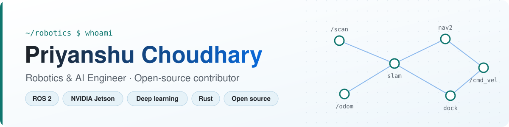

<picture>
  <source media="(prefers-color-scheme: dark)" srcset="assets/banner-dark.svg">
  
</picture>

  
  
  
  
  

## 👋 About me

I build robots that work on their own: **ROS 2 navigation on a Jetson Nano**, **camera-only driving**, **GPS-denied drone flight**, and robots that **learn to dock** with reinforcement learning. I also build **backends**: Java and Spring Boot APIs, secure code-execution services, and cloud deployments on AWS. I'm a final-year CSE student, and an active open-source contributor across systems programming, robotics, and developer tooling.

- 🤖 **Now building:** autonomous charger docking for my ROS 2 robot, plus CARLA simulation for its perception stack
- ☕ **Backend:** Spring Boot, Spring Security + JWT, MongoDB, Redis, Docker, AWS (S3, SQS, EC2)
- 🌐 **Open Source:** Actively contributing upstream across Rust systems, robotics middleware, and developer tooling

## 🌍 Open-source contributor

I believe in giving back to the community and contributing upstream to the tools and ecosystems I use every day. Rather than confining myself to a single repository, I actively contribute fixes, features, and compatibility improvements across diverse domains:

<table>
<tr>
<td width="50%" valign="top">

### 🦀 Core Systems & CLI Tooling
Contributing upstream bug fixes, POSIX/GNU compatibility improvements, and edge-case handling to high-performance systems and command-line utilities in Rust and C.

`Rust` `Systems Programming` `CLI Tools` `POSIX / GNU`

</td>
<td width="50%" valign="top">

### 🤖 Robotics & Middleware Runtimes
Tackling race conditions, dataflow pipelines, and CLI diagnostics across distributed robotics and agentic middleware frameworks.

`ROS 2` `dora-rs` `C++` `Robotics Stack`

</td>
</tr>
<tr>
<td width="50%" valign="top">

### 📐 3D Geometry & Graphics Engines
Resolving algorithmic edge cases in geometry kernels, cross-platform path handling, and UI/font fallback discovery for parametric CAD tools.

`Computational Geometry` `Cross-Platform` `Wasm / Node`

</td>
<td width="50%" valign="top">

### 🔍 Upstream Bug Hunting & Triage
Reporting upstream issues with deep root-cause analysis, reproducible minimal test cases, and clean companion pull requests with regression tests.

`Issue Triage` `Unit & Regression Tests` `CI / Workflows`

</td>
</tr>
</table>

  
  &nbsp;
  

## 🤖 Robotics & AI projects

<table>
<tr>
<td width="50%" valign="top">

### 🤖 [Perceptron: ROS 2 robot](https://github.com/Priyanshu-choudhary/Perceptron_Ros2_Jetson_local)
A four-wheel robot that maps a room, localizes itself, drives to goals and **plugs itself into its charger**, all on a Jetson Nano.

`ROS 2` `Nav2` `SLAM Toolbox` `ArUco docking ±3 cm` `Gazebo`

</td>
<td width="50%" valign="top">

### 🚗 [Vision-only autonomous car](https://github.com/Priyanshu-choudhary/Perceptron)
Drives with **only a camera**, no LiDAR, radar or GPS. Deep-learning perception optimized with TensorRT for real-time inference on a Jetson.

`Python` `TensorRT` `Jetson` `Deep learning`

</td>
</tr>
<tr>
<td width="50%" valign="top">

### 🚁 [GPS-denied drone (IIT Delhi)](https://github.com/Priyanshu-choudhary/IIT_D-dorne-code)
Navigates, searches and lands **without GPS**, using a depth camera and deep neural networks on a Jetson Orin.

`Depth vision` `Deep learning` `Jetson Orin`

</td>
<td width="50%" valign="top">

### 🔋 [RL self-docking car](https://github.com/Priyanshu-choudhary/Reinforcement_learning_self_docking-)
A robot car that **learns** to find, align with and park into its charging dock through PPO training, with no hard-coded docking logic.

`PPO` `OpenAI Gym` `ROS 2` `Jetson Nano`

</td>
</tr>
</table>

## ⚙️ Backend engineering

<table>
<tr>
<td width="50%" valign="top">

### 🏆 [CFC: coding-platform backend](https://github.com/Priyanshu-choudhary/CFC_Backend)
The backend of a competitive-coding platform: **courses, contests, problems, lectures and skill tracking**, with role-based auth and file uploads.

`Java` `Spring Boot` `Spring Security` `JWT` `MongoDB` `Redis` `AWS S3` `AWS SQS` `Spring AI` `Prometheus` `Docker`

</td>
<td width="50%" valign="top">

### 📦 [GoBoxD: code-execution sandbox](https://github.com/Priyanshu-choudhary/code-sandbox)
An HTTP service that compiles and runs **untrusted code** in isolated Linux sandboxes, with a queue-based distributed design.

`Go` `FastAPI` `nsjail` `Redis` `AWS SQS` `Docker`

</td>
</tr>
</table>

<b>More projects</b>

 

- 🎥 [Internet-based camera](https://github.com/Priyanshu-choudhary/Internet_based_camera): live video from a Raspberry Pi to anywhere, through a WebRTC server on AWS EC2
- 🩺 [Orthopedic SSI infection detection](https://github.com/Priyanshu-choudhary/orthopedic-SSI-Infection-detection-): ML models, API and frontend for surgical-site infection detection
- 🧠 [LLM workshop](https://github.com/Priyanshu-choudhary/LLM_workshop): college workshop building a tiny GPT-style language model from scratch
- 📡 [TinyTLV protocol](https://github.com/Priyanshu-choudhary/TinyTVLx): binary-safe framing protocol for microcontrollers and stream links, shared between Arduino/C++ and Python
- ☕ [CS Party backend](https://github.com/Priyanshu-choudhary/CSPartyBackend) and [Byte Task backend](https://github.com/Priyanshu-choudhary/byte-task-Backend): Java backends for event registration and subscriptions
- 👀 [Stereo camera algorithms](https://github.com/Priyanshu-choudhary/Stereo-camera-Algo-s): depth from stereo vision

  

---

Building robots, fixing bugs, learning in public · thanks for visiting ✨

