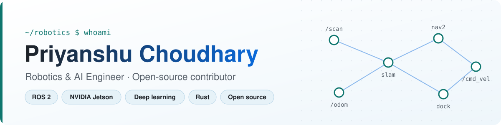

<picture>
  <source media="(prefers-color-scheme: dark)" srcset="assets/banner-dark.svg">
  
</picture>

  
  
  
  

## 👋 About me

I build robots that work on their own: **ROS 2 navigation on a Jetson Nano**, **camera-only driving**, **GPS-denied drone flight**, and robots that **learn to dock** with reinforcement learning. I'm a final-year CSE student, and I contribute to open-source projects in Rust, C and Python.

- 🤖 **Now building:** autonomous charger docking for my ROS 2 robot, plus CARLA simulation for its perception stack
- 🦀 **Contributing to:** [uutils/coreutils](https://github.com/uutils/coreutils), the Rust rewrite of GNU coreutils
- 🎯 **Aiming for:** Google Summer of Code 2027, in robotics and systems software

## 🌍 Open-source contributions

| | Project | Contribution | |
| :---: | --- | --- | :---: |
| 🦀 | [**uutils/coreutils**](https://github.com/uutils/coreutils) Rust rewrite of GNU coreutils | [`ln`: report "same file" for every backup mode](https://github.com/uutils/coreutils/pull/15545) bug fix + tests, checked against GNU 9.12 |  |
| 📐 | [**SolidCraft**](https://github.com/tangency-labs/solidcraft) parametric 3D CAD in Rust | [Find a Chinese fallback font on Linux and Windows](https://github.com/tangency-labs/solidcraft/pull/3466) font discovery fix for the zh-CN UI |  |
| 🐢 | [**ROS 2 CLI**](https://github.com/ros2/ros2cli) command-line tools for ROS 2 | [`ros2` prints a `BrokenPipeError` traceback when piped to `head`](https://github.com/ros2/ros2cli/issues/1342) bug report with root-cause analysis |  |

➜ [All my pull requests to other projects](https://github.com/pulls?q=is%3Apr+author%3APriyanshu-choudhary+-user%3APriyanshu-choudhary)

## 🚀 Featured projects

<table>
<tr>
<td width="50%" valign="top">

### 🤖 [Perceptron: ROS 2 robot](https://github.com/Priyanshu-choudhary/Perceptron_Ros2_Jetson_local)
A four-wheel robot that maps a room, localizes itself, drives to goals and **plugs itself into its charger**, all on a Jetson Nano.

`ROS 2` `Nav2` `SLAM Toolbox` `ArUco docking ±3 cm` `Gazebo`

</td>
<td width="50%" valign="top">

### 🚗 [Vision-only autonomous car](https://github.com/Priyanshu-choudhary/Perceptron)
Drives with **only a camera**, no LiDAR, radar or GPS. Deep-learning perception optimized with TensorRT for real-time inference on a Jetson.

`Python` `TensorRT` `Jetson` `Deep learning`

</td>
</tr>
<tr>
<td width="50%" valign="top">

### 🚁 [GPS-denied drone (IIT Delhi)](https://github.com/Priyanshu-choudhary/IIT_D-dorne-code)
Navigates, searches and lands **without GPS**, using a depth camera and deep neural networks on a Jetson Orin.

`Depth vision` `Deep learning` `Jetson Orin`

</td>
<td width="50%" valign="top">

### 🔋 [RL self-docking car](https://github.com/Priyanshu-choudhary/Reinforcement_learning_self_docking-)
A robot car that **learns** to find, align with and park into its charging dock through PPO training, with no hard-coded docking logic.

`PPO` `OpenAI Gym` `ROS 2` `Jetson Nano`

</td>
</tr>
<tr>
<td width="50%" valign="top">

### 📦 [GoBoxD: code sandbox](https://github.com/Priyanshu-choudhary/code-sandbox)
An HTTP service that compiles and runs **untrusted code** in isolated Linux sandboxes, with a queue-based distributed design.

`Go` `FastAPI` `nsjail` `Redis` `AWS SQS`

</td>
<td width="50%" valign="top">

### 📡 [TinyTLV protocol](https://github.com/Priyanshu-choudhary/TinyTVLx)
A minimal, **binary-safe framing protocol** for microcontrollers and stream links (UART, WebSockets), shared between Arduino/C++ and Python.

`C++` `Python` `Embedded`

</td>
</tr>
</table>

<b>More projects</b>

 

- 🎥 [Internet-based camera](https://github.com/Priyanshu-choudhary/Internet_based_camera): live video from a Raspberry Pi to anywhere, through a WebRTC server on AWS EC2
- 🩺 [Orthopedic SSI infection detection](https://github.com/Priyanshu-choudhary/orthopedic-SSI-Infection-detection-): ML models, API and frontend for surgical-site infection detection
- 🧠 [LLM workshop](https://github.com/Priyanshu-choudhary/LLM_workshop): college workshop building a tiny GPT-style language model from scratch
- ☕ [CFC backend](https://github.com/Priyanshu-choudhary/CFC_Backend): Spring Boot REST backend with Docker
- 👀 [Stereo camera algorithms](https://github.com/Priyanshu-choudhary/Stereo-camera-Algo-s): depth from stereo vision

## 🛠️ Tech stack

  <b>Robotics & AI</b>  
   
  
  
  
  
  
  

  <b>Languages</b>  
  

  <b>Backend & tools</b>  
  

---

Building robots, fixing bugs, learning in public · thanks for visiting ✨

